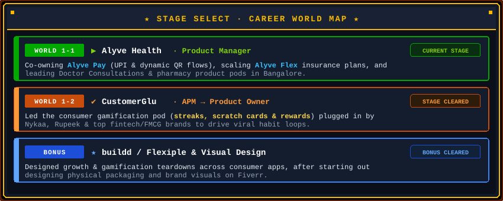
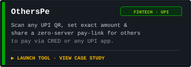
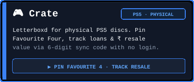
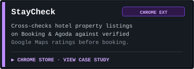
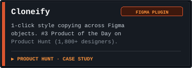

  

# Sannan — Mohammed Sannan V S

I'm **Sannan** (**Mohammed Sannan V S**), a Product Manager at [Alyve Health](https://www.alyve.health/) in **Bangalore, India** (previously **CustomerGlu**) and builder of weekend software tools, Chrome extensions, and AI experiments.

By day I build consumer health and UPI payment products at [Alyve Health](https://www.alyve.health/). On weekends I get annoyed by a 15-second workflow problem and prototype or ship a small software tool to eliminate it.

  
  
  
  
  

---

## 🏰 Stages & Progression

  

---

## 🍄 Power-Ups Shipped

<table align="center" width="100%">
  <tr>
    <td width="50%" align="center">
      
       
      <a href="https://otherspe.vercel.app/"><b>Live Demo</b></a> · 
      <a href="https://msannan.vercel.app/otherspe.html">Case Study</a> · 
      <a href="https://github.com/m-sannan/otherspe">GitHub</a>
    </td>
    <td width="50%" align="center">
      
       
      <a href="https://ps5-shelf.vercel.app/"><b>Live Demo</b></a> · 
      <a href="https://msannan.vercel.app/crate.html">Case Study</a> · 
      <a href="https://github.com/m-sannan/ps5-shelf">GitHub</a>
    </td>
  </tr>
  <tr>
    <td width="50%" align="center">
      
       
      <a href="https://chromewebstore.google.com/detail/staycheck/mjgdchcpacfmgocenlemmbecmcbiahkb"><b>Chrome Web Store</b></a> · 
      <a href="https://msannan.vercel.app/staycheck.html">Case Study</a> · 
      <a href="https://github.com/m-sannan/staycheck">GitHub</a>
    </td>
    <td width="50%" align="center">
      
       
      <a href="https://cloneify.framer.ai/"><b>Product Hunt (#3 of Day)</b></a> · 
      <a href="https://msannan.vercel.app/cloneify.html">Case Study</a>
    </td>
  </tr>
</table>

🎒 <b>Side Quests & Weekend Experiments (Sheeto, EchoLog, NearU, Movemint...)</b>

 

* ⚡ **[Sheeto](https://6014760986164.gumroad.com/l/sheeto)** ([case study](https://msannan.vercel.app/sheeto.html) · [repo](https://github.com/m-sannan/Sheeto)) — Native macOS and Windows desktop utility that opens any local `.xlsx`, `.xls`, or `.csv` file straight into Google Sheets on double-click.
* 🛰️ **[EchoLog](https://github.com/m-sannan/echolog)** & **[Splitwise Local](https://msannan.vercel.app/splitwise-local.html)** — Chrome extension that silently buffers background XHR/Fetch API calls for 1-click reproducible bug reports, plus a zero-paywall trip expense splitter.
* 📡 **[NearU](https://m-sannan.github.io/nearu/)** & **[Movemint](https://m-sannan.github.io/movemint-codex/)** — Android BLE proximity POC & indie marketing codex.
* 📂 **[SnapNotes](https://github.com/m-sannan/snapnotes)** & **[All projects index ↗](https://m-sannan.github.io/)**

---

## 📜 Quest Log & Product Teardowns

Read all 16 product teardowns and case studies on [msannan.vercel.app/blog.html](https://msannan.vercel.app/blog.html):

| Teardown / Deep Dive | Focus Area | Read |
| :--- | :--- | :--- |
| 🪙 **How might we simplify Senior citizens' experience of UPI apps?** | Fintech · Accessibility | [Read ↗](https://msannan.vercel.app/blog/how-might-we-simplify-senior-citizens-experience-of-upi-apps.html) |
| 🛒 **How to improve the Cart Conversion rate? (Blinkit vs. Zepto)** | Quick Commerce · Growth | [Read ↗](https://msannan.vercel.app/blog/how-to-improve-the-cart-conversion-rate.html) |
| 🍔 **Decreasing missing item issues in food delivery apps (Swiggy)** | Operations & Product UX | [Read ↗](https://msannan.vercel.app/blog/how-might-we-decrease-missing-item-issues-in-food-delivery-apps-using-swiggy.html) |
| 🍟 **How can we use Psychology to make customers spend more? (KFC & McDonald's)** | Consumer Psychology | [Read ↗](https://msannan.vercel.app/blog/how-can-we-use-psychology-to-make-customers-spend-more.html) |
| 💼 **Why should PMs give sales demos?** | Product Leadership | [Read ↗](https://msannan.vercel.app/blog/why-should-pms-give-sales-demos.html) |

---

## 🏆 High Scores

  
  

